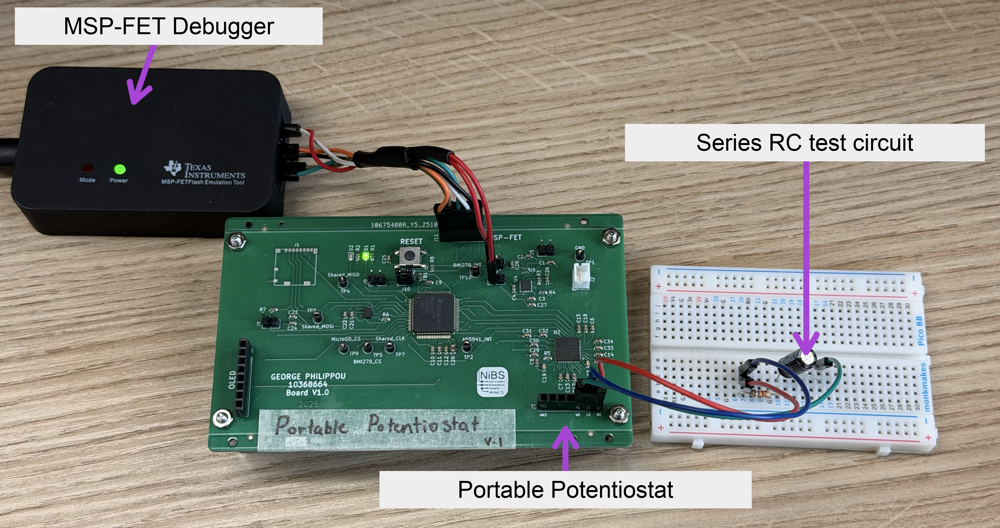

# Portable potentiostat

Firmware, Python dashboard and setup guides for the MSP430FR5994/AD5941 development board, using the TI MSP-FET for programming and UART communication.

## System setup

<p align="center">
  
</p>
<p align="center"><em>MSP-FET, development board and breadboard RC test load.</em></p>

The photo shows a bench test load. Use the [numbered connection tables](docs/HARDWARE.md) for the selected experiment and sensor.

## Get started

1. [Download the firmware ZIP for your technique](downloads/README.md) and the **[Python dashboard ZIP](https://github.com/GeorgePhilippou/portable-potentiostat-handover-personal/raw/refs/heads/main/downloads/Python_Dashboard.zip)**, then extract both.
2. Follow the [connection guide](docs/HARDWARE.md). In Code Composer Studio, import, build and flash the selected firmware project.
3. In the extracted **Python_Dashboard** folder, install the dependencies:
   ```sh
   python -m pip install -r requirements.txt
   ```
4. Run **`potentiostat_dashboard.py`** from that folder, select the serial port if needed, and press **Detect and open**. The launcher identifies the firmware and opens its dashboard. For the cyclic-voltammetry firmware, choose **CV** or **LSV** mode.
5. Set the experiment parameters, press **Start**, then use **Save session** to save the raw measurements and plot.

The **[Start here guide](docs/START_HERE.md)** covers the complete setup, connection troubleshooting and plot controls. **[Dashboard previews](docs/DASHBOARDS.md)** show each experiment's interface.

## Experiments and firmware

| Experiment | Firmware download | Status |
|---|---|---|
| Open-circuit potential (OCP) | [OCP ZIP](https://github.com/GeorgePhilippou/portable-potentiostat-handover-personal/raw/refs/heads/main/downloads/firmware/Handover_OCP.zip) | Bench tested with internal references |
| Chronoamperometry | [Chronoamperometry ZIP](https://github.com/GeorgePhilippou/portable-potentiostat-handover-personal/raw/refs/heads/main/downloads/firmware/Handover_Chronoamperometric.zip) | Bench tested with a series RC load |
| Amperometry | [Amperometry ZIP](https://github.com/GeorgePhilippou/portable-potentiostat-handover-personal/raw/refs/heads/main/downloads/firmware/Handover_Amperometric.zip) | Bench tested with a resistor |
| Cyclic voltammetry (CV), with linear sweep (LSV) mode | [CV / LSV ZIP](https://github.com/GeorgePhilippou/portable-potentiostat-handover-personal/raw/refs/heads/main/downloads/firmware/Handover_CyclicVoltammetry.zip) | Both modes bench tested with a resistor |
| Electrochemical impedance spectroscopy (EIS) | [EIS ZIP](https://github.com/GeorgePhilippou/portable-potentiostat-handover-personal/raw/refs/heads/main/downloads/firmware/Handover_EIS.zip) | In development |

**CV and LSV use one firmware project.** CV sweeps to a vertex potential and back; LSV performs a one-way sweep from start to end. Choose the required mode in the Python launcher; switching between these modes does not require reflashing.

One Python dashboard download supports all of these experiments. Use firmware and dashboard ZIPs from the same [downloads page](downloads/README.md). See the [tested settings and current limits](docs/VALIDATION.md), including the unfinished EIS range.

## Configure for your experiment

Both firmware and dashboard are editable source. The [customisation guide](docs/CUSTOMISATION.md) identifies where to change ADC inputs, gain, acquisition settings, dashboard controls, plotting and data export. It also explains which changes require rebuilding and reflashing the board.

[Schematic, PCB layout and ADI application note](docs/hardware/README.md) · [Measured examples](examples/) · [Validation details](docs/VALIDATION.md)

## Author and acknowledgements

Developed by **George Philippou**, University of Manchester · [Non-Invasive Bioelectronics Lab](https://github.com/Non-Invasive-Bioelectronics-Lab).

The firmware includes Analog Devices and Texas Instruments components; see [third-party notices](THIRD_PARTY_NOTICES.md).
