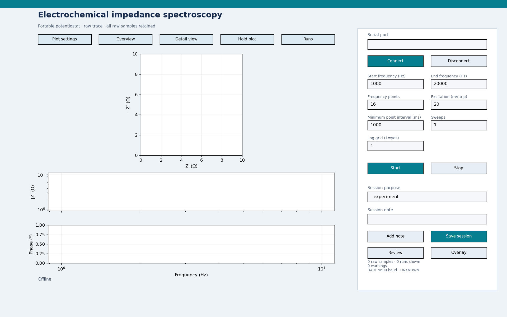

# Dashboard guide

Use this page to see each experiment's dashboard and understand its controls. For installation, flashing and wiring, follow [Start here](START_HERE.md). The screenshots show the current interface using saved bench data; the EIS screenshot is an empty offline preview.

[Common controls](#common-controls) · [OCP](#open-circuit-potential-ocp) · [Chronoamperometry](#chronoamperometry) · [Amperometry](#amperometry) · [CV and LSV](#cyclic-voltammetry--cv-and-lsv-modes) · [EIS](#eis--in-development)

## Open the right experiment

Run `potentiostat_dashboard.py` from the extracted **Python_Dashboard** folder. Choose **Automatic** or the MSP-FET Application UART port and press **Detect and open**. The launcher identifies the flashed firmware and opens its controls. For the shared cyclic-voltammetry firmware, select **CV** or **LSV** mode in the launcher. Detection does not start a measurement.

The launcher also offers **Open offline** to inspect an interface without a connected board. Offline mode does not generate measurement data.

## Common controls

The plot is on the left. Connection, experiment settings, notes and acquisition controls are on the right. Status text below the plot reports connection/acquisition progress; the right-hand summary reports samples, warnings and available measurement metadata.

| Control | What it does |
|---|---|
| Serial port / Connect | Opens the selected port and requests firmware identification. Close other serial terminals first. |
| Disconnect | Releases the serial port. Use **Stop** first if a measurement is running; disconnecting alone does not stop the board. |
| Start | Sends the displayed experiment settings to the board. Wait for the connected device to be ready/IDLE before starting. |
| Stop | Requests that the board stop. Check the status for completion. |
| Session purpose | Describes the measurement and helps form the suggested save filename. |
| Session note / Add note | Adds contextual information to the saved session. |
| Save session | Saves the raw samples and session metadata to CSV, plus a PNG of the current plot. Choose a new filename for each save. Save before closing the window. |
| Review | Opens a previously saved handover CSV for inspection. Disconnect from the board first. |
| Overlay | Adds a saved recording or supported CSV as a comparison trace. Existing measurements remain available. |

### View and compare plots

| Control | What it does |
|---|---|
| Overview | Shows a broad view including zero. For CV/LSV, the potential axis follows the sweep; the current axis includes zero. |
| Detail view | Uses close automatic scaling and returns displayed averaging to raw samples. Small fluctuations can look large in this view. |
| Plot settings | Sets automatic/fixed limits, time windows where supported, trace style, grid, legend and display averaging. |
| Hold plot / Resume plot | Freezes/resumes the displayed plot. Acquisition continues while the display is held. |
| Runs | Shows/hides individual recorded runs and imported overlays. **Clear plot** unchecks all; **Show all** restores them. Press **OK** to apply. Hiding traces does not delete samples. |
| Native plot toolbar | Zooms, pans and saves the figure. Use **Overview** to reset the view. The toolbar appears in the interactive window and is not included in these exported screenshots. |

Display averaging changes only the plotted curve; the CSV retains the original samples. Use an average of **1** for the unaveraged trace, especially when examining fast transients. Fixed limits control the visible scale, not the ADC range or gain.

## Open-circuit potential (OCP)

**Plot:** voltage in volts against time in seconds. The vertical-axis label follows the firmware's measurement convention: electrode WE−RE potential or an internal/differential ADC test voltage.

| Setting | Meaning |
|---|---|
| Duration (s) | Length of the recording; **0** continues until Stop. |
| Sampling frequency (Hz) | Requested reporting frequency, from 0.1 to 20 readings per second. |

The supplied firmware uses internal-reference inputs for a diagnostic. For electrode OCP, select the required ADC inputs in `Handover_OCP/main.c`, rebuild/reflash and follow the [OCP wiring instructions](HARDWARE.md#sensor--dummy-load-header--j3). Changing a plot setting does not change the ADC inputs.

## Chronoamperometry

**Plot:** current in microamps against time after the potential step. The board holds the initial potential, applies the selected step potential and records the transient.

| Setting | Meaning |
|---|---|
| Initial (mV) | Potential applied during the initial hold. |
| Step (mV) | Final applied potential after the step; this is an absolute potential, not the size of the change. |
| Duration (s) | Acquisition time after stepping. |
| Initial hold (ms) | Time spent at the initial potential before stepping. |

The acquisition rate is set by the firmware, approximately **150 samples/s** in the bench-checked build; it is not a dashboard setting. The board buffers the acquisition and sends it afterwards at 9600 baud, so the curve appears after acquisition/transfer rather than immediately. Allow transfer to finish before saving. The sampling frequency and UART baud are different quantities.

## Amperometry

**Plot:** current in microamps against time while holding a constant potential.

| Setting | Meaning |
|---|---|
| Potential (mV) | Applied WE−RE potential for the run. |
| Duration (s) | Recording length; **0** continues until Stop. |
| Sampling frequency (Hz) | Requested reporting frequency, from 0.1 to 20 readings per second. |

A resistor load should approach a steady current at a fixed potential. Sensor behaviour and settling depend on the connected load; the recorded bench checks are described in [validation](VALIDATION.md).

## Cyclic voltammetry — CV and LSV modes

Both modes use **`Handover_CyclicVoltammetry`** and the same Python download. Choose the mode in the launcher. CV sweeps to a vertex and returns; LSV performs a one-way sweep. Switching modes does not require reflashing.

### CV mode

### LSV mode

**Plots:** current against WE−RE potential on the upper plot, and current against time within the sweep on the lower plot.

| Setting | Meaning |
|---|---|
| Start (mV) | Starting applied potential. |
| Vertex (mV), CV | Turning potential before the return scan. |
| End (mV), LSV | Final potential of the one-way scan. |
| Points | Number of programmed sweep steps. CV uses an even total across the forward and return scan; LSV uses the one-way count. |
| Scan rate (mV/s) | Rate of potential change. Together with the potential span and point count, this determines the step interval. |
| Sample delay (ms) | Delay after each potential update before sampling. It must fit within the step interval. |
| Cycles, CV / Sweeps, LSV | Number of repeated scans. |
| Initial hold (ms) | Hold at the starting potential before the scan. |

The dashboard checks combinations of scan rate, points and sample delay before sending Start. The displayed sampling frequency is derived from the programmed sweep schedule; UART baud is the transfer speed. For this mode, fixed plot limits apply to the potential plot.

## EIS — in development

**This is an offline layout preview, with no acquired points. The current EIS firmware still requires board validation.** The controls accepting a frequency do not demonstrate that it has been successfully measured. See [EIS status](EIS_DEVELOPMENT.md).

**Plots:** Nyquist impedance (Z′ against −Z″), impedance magnitude against frequency, and phase against frequency. Frequency axes on the magnitude/phase plots are logarithmic.

| Setting | Meaning |
|---|---|
| Start / End frequency (Hz) | Requested frequency sweep limits. The target range is 0.1 Hz–200 kHz; the complete range is not validated. |
| Frequency points | Number of frequency points in a sweep. |
| Excitation (mV p-p) | Peak-to-peak AC excitation amplitude. |
| Minimum point interval (ms) | Minimum requested spacing between points, not a guaranteed acquisition time. Slow points may require much longer. |
| Sweeps | Number of repeated frequency sweeps. |
| Log grid (1=yes) | **1** spaces frequencies logarithmically; **0** uses linear spacing. |

For EIS, Plot settings limits apply to the Nyquist plot. Display averaging is disabled for impedance points.
