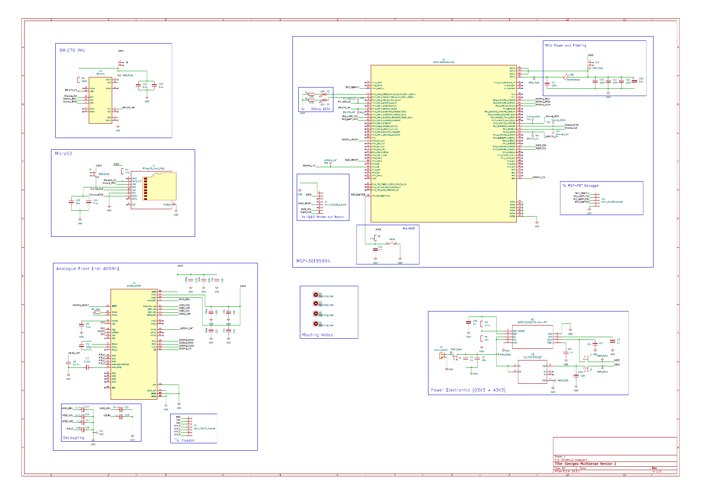
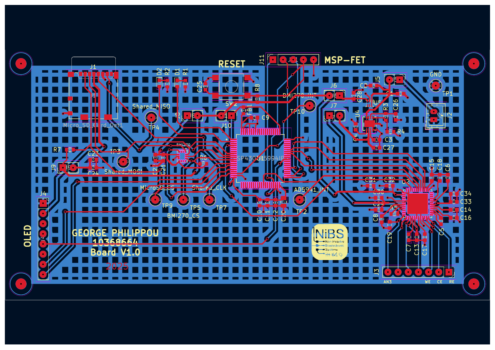

# Board drawings and application reference

The schematic, PCB layout and application note are provided as PDF references. Use the PDFs for zooming into component values, nets and header labels; the images below are browsing previews.

## Schematic

[Open or download Schematic.pdf](Schematic.pdf) — one-page schematic export from KiCad, exported 13 October 2026.

The sheet identifies its KiCad file as `Version_2.kicad_sch`; its title is “Georges Multisense Version 1”. These are retained source labels, not renamed hardware revisions. The schematic contains the MCU, AD5941, power, header and additional-peripheral circuitry. Its presence does not mean every component is populated or used by the demonstrated firmware. Follow the [handover connections](../HARDWARE.md) for the tested assembly configuration.

## PCB layout

[Open or download PCB_Layout.pdf](PCB_Layout.pdf) — one-page PCB layout export from KiCad, exported 13 October 2026.

The supplied layout silkscreen reads **Board V1.0**. The handover's “Version 2” wording refers to the KiCad project used for the bench work; do not infer a new physical revision from the filename alone. Confirm the header labels and orientation on the actual assembly. This is a layout drawing. The [actual assembly photograph](../HARDWARE.md#assembly-photo) shows the prepared jumper harness, MSP-FET and breadboard RC test load.

These PDFs are **reference exports**, not editable KiCad source or a manufacturing package. To modify the hardware design, obtain the corresponding native KiCad schematic/PCB files, project libraries and appropriate fabrication checks.

## Analog Devices application note

[Read AN-1563: Optimizing the AD5940 for Electrochemical Measurements](../references/AnalogDevices_2019_AN_1563_Rev_0.pdf), by Micheál Lambe, Analog Devices, Rev. 0 (2019), 16 pages.

Useful sections in the document's printed page numbers:

| Topic | Starts on page |
|---|---|
| AD5940 measurement loop and electrochemical/potentiostat measurement theory | 3 |
| Amperometric measurement | 5 |
| Chronoamperometry / pulse test | 7 |
| Cyclic voltammetry | 9 |
| Square-wave voltammetry | 11 |
| Electrochemical impedance spectroscopy and three-wire measurement | 12 |
| Two-wire EIS and sensor DC bias | 16 |

This is manufacturer background for understanding the measurement loops and adapting the firmware. Its examples use the AD5940 evaluation kit and IAR; their board connections and run instructions are not the operating procedure for this MSP430/AD5941 handover. The square-wave section does not imply that square-wave voltammetry is implemented here. Use the [Start Here guide](../START_HERE.md), [customisation map](../CUSTOMISATION.md) and [actual validation status](../VALIDATION.md) for this repository.

Analog Devices retains the note's authorship/copyright. The supplied copy is included intact. [Document checksums](DOCUMENT_MANIFEST.json) identify the exact source PDFs.
